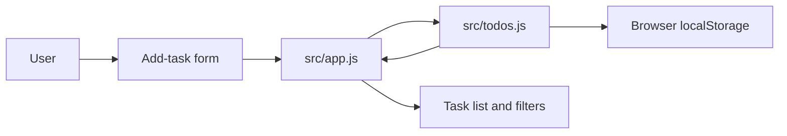

# TODO-001 Architecture

## Architecture Summary

Daymark remains a static client-side application. The feature extends the Todo
domain model with an optional validated ISO date-only `dueDate`, centralizes
overdue rules in a pure Todo-module helper, and renders the resulting state in
the existing DOM layer. Browser local storage remains the persistence boundary;
storage write failures preserve in-memory state and are reported accessibly.

Source: `docs/sdlc/requirements.md`. Approval: `docs/sdlc/approval-log.md`.

## Component Diagram

## Components And Responsibilities

| Component | Responsibility | Depends On |
|---|---|---|
| `index.html` | Provides the optional date input and `Overdue` filter control. | Browser DOM |
| `src/todos.js` | Creates compatible Todo records; validates date-only values; exposes pure overdue and filtering rules; reports storage-write success or failure. | Browser date APIs, local storage |
| `src/app.js` | Handles user events and renders dates, empty states, accessible overdue status, and non-blocking persistence errors. | DOM, `src/todos.js` |
| `styles.css` | Presents responsive due-date metadata and a distinct overdue state. | Rendered DOM |
| Browser local storage | Persists Todo records while allowing records without `dueDate`. | Browser |
| `test/todos.test.js` | Verifies date rules, persistence compatibility, and filters without depending on the current system date. | Node test runner, `src/todos.js` |

## Technology Choices

| Choice | Reason | Alternatives Considered |
|---|---|---|
| Vanilla JavaScript | Matches the existing application and keeps the feature small and dependency-free. | React or a date library would add unnecessary build and runtime complexity. |
| HTML `input[type=date]` | Supplies accessible, locale-aware browser date entry and a standard date-only value. | Free-text input would require extra parsing and validation. |
| Date-only ISO string | Avoids time-zone shifts caused by serializing an instant for a calendar-date requirement. | JavaScript `Date` timestamps are unsuitable as the persisted representation. |
| Pure overdue helper with injected current date | Makes local-date behavior deterministic and testable; invalid dates return false. | Reading the current time directly in rendering logic would make tests fragile. |
| Browser local storage | Preserves the app's existing local-first, single-user model. | A backend is outside the approved scope. |

## Data Flow

1. The user enters a title and optionally selects a due date in the add-task form.
2. `src/app.js` passes both values to `src/todos.js`, which creates a Todo with
   an optional date-only `dueDate`.
3. `src/app.js` asks the Todo module to store the updated Todo array in browser
   local storage. On failure, the app retains its in-memory data and displays an
   accessible non-blocking error.
4. On load and on each update, `src/app.js` obtains Todos from `src/todos.js`.
5. The Todo module validates date-only values, evaluates whether each incomplete
   dated Todo is overdue using an explicit local calendar date, and applies the
   selected filter. Missing or invalid due dates are not overdue.
6. The app layer renders task text with `textContent`, date metadata, overdue
   state, and the appropriate empty message.

## Requirements Traceability

| Requirement | Architecture Coverage |
|---|---|
| FR-1 to FR-3 | `index.html`, `src/app.js`, and `src/todos.js` support entry, storage, and display. |
| FR-4 to FR-6 | The Todo-domain overdue helper evaluates date and completion state. |
| FR-7 to FR-9 | `src/app.js` and `index.html` add and render the `Overdue` filter and empty state. |
| FR-10 | `loadTodos` retains Todo records that have no `dueDate`. |
| NFR compatibility, date handling, and quality | Date-only model and pure helper are verified through Node tests. |
| NFR accessibility, responsive design, and security | Semantic inputs, programmatic status text, accessible persistence errors, responsive CSS, and DOM `textContent` rendering are retained. |

## Assumptions And Risks

| Item | Impact | Mitigation |
|---|---|---|
| Native date-input appearance differs by browser | Minor visual variation | Use the semantic native control and style surrounding layout only. |
| Invalid legacy `dueDate` values may exist | Could cause inaccurate state | Validate the ISO date-only value; treat missing or invalid values as no due date. |
| Local storage can be unavailable or full | Save can fail | Return save failure to the app layer, retain in-memory state, and surface a non-blocking accessible error. |
| Current local date changes while the page remains open | Overdue state can become stale at midnight | Recalculate on every render and user interaction; live midnight refresh is out of scope. |
